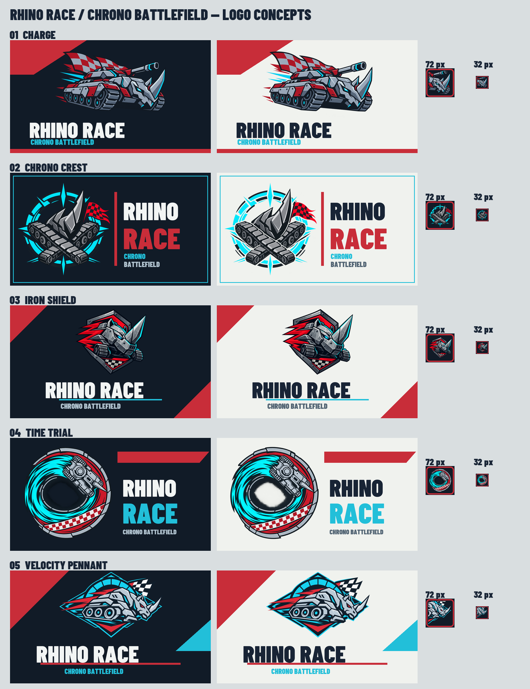

# Rhino Race — Chrono Battlefield logo concepts

Five original directions for choosing a game and stream identity. Each concept has a 1024 × 576 preview on dark and light backgrounds, plus square 72 × 72 and 32 × 32 icon variants. The previews can be placed on a 1920 × 1080 stream card; the small variants are for Stream Deck and favicon use.

Concept 4, [Time Trial](concept-4/notes.md), was selected. Use the [final exports](final/README.md) for production.

## Contact sheet

| Concept | Idea | Files |
| --- | --- | --- |
| [1 — Charge](concept-1/notes.md) | Charging tank and checked racing flag | [Dark](concept-1/dark.png) · [Light](concept-1/light.png) · [72 px](concept-1/72.png) · [32 px](concept-1/32.png) |
| [2 — Chrono Crest](concept-2/notes.md) | Horn and treads inside a portal ring | [Dark](concept-2/dark.png) · [Light](concept-2/light.png) · [72 px](concept-2/72.png) · [32 px](concept-2/32.png) |
| [3 — Iron Shield](concept-3/notes.md) | Armored rhino on a diagonal shield | [Dark](concept-3/dark.png) · [Light](concept-3/light.png) · [72 px](concept-3/72.png) · [32 px](concept-3/32.png) |
| [4 — Time Trial](concept-4/notes.md) | Tank racing around a chrono track | [Dark](concept-4/dark.png) · [Light](concept-4/light.png) · [72 px](concept-4/72.png) · [32 px](concept-4/32.png) |
| [5 — Velocity Pennant](concept-5/notes.md) | Rhino tank breaking through a chrono arch | [Dark](concept-5/dark.png) · [Light](concept-5/light.png) · [72 px](concept-5/72.png) · [32 px](concept-5/32.png) |

The illustrations were generated for this project from original prompts. They contain no EA or Westwood game artwork or marks. The lettering uses [Barlow Condensed Black](fonts/BarlowCondensed-Black.ttf) under the [SIL Open Font License 1.1](fonts/OFL.txt), which permits use in a GPL project and commercial stream.
