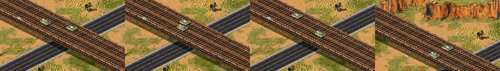

# Can tanks drive on the side cells of a high bridge deck?

Issue #66. Follows [ra2-locomotion.md](ra2-locomotion.md) §5 and [supported-battlefields.md](supported-battlefields.md) §3.

## Answer

**Yes.** A high bridge's deck is wider than the one overlay line FA2 places: at least the cells either side of it are deck, matching the art's three-cell width. Two Rhinos that start on the same row and drive head-on across Hills' long wooden bridge pass each other side by side, in different lanes, without either one stopping or backing off. Sent on to cells beside the overlay line, each one stops up on the deck rather than driving down to the ground below.

For our grid this means the side cells of a high bridge get a deck layer like the overlay line itself does. Today the deck is one cell wide, which makes Bridge Run's bridge a single-file choke that RA2 doesn't have.

*Hills, overlay line (76..97, 75). First three panels, 0.2 s apart: the Rhinos meet mid-bridge in different lanes, pass side by side, and drive on. Last panel, end of the run (the view had drifted): both are parked on the deck planks, where their scripts sent them, (86, 74) and (86, 76). Their screen offset, about (−55, +35) px, matches two cells across the bridge, 2 × (−30, +15); that they are on the planks rather than the ground is read from the picture.*

## Test

`tools/corner-cut-test/bridge_side_test.py` reuses the launcher from the [corner-cutting test](ra2-corner-cutting.md).

- **Map.** It uses the install's loose `Maps/Yuri's Revenge/xhills.map`, whose `[IsoMapPack5]` and `[OverlayPack]` are byte-identical to `Hills.mmx`'s encrypted copy. The script drops `[Digest]` and adds waypoints, two task forces, scripts and teams, and triggers.
- **Rhinos.** At about 2 s a trigger reinforces Rhino W at (73, 75) and Rhino E at (101, 75), the course waypoints just off each end of the deck. W's script moves it to E's start and then to (86, 74). E's script moves it to W's start and then to (86, 76).
- **Reading the result.**
  - Head-on: if the deck were one cell wide, one Rhino would have to wait, back off or detour. Both drove straight through.
  - Side cells: a destination spanned by a bridge is reached at deck height ([ra2-locomotion.md](ra2-locomotion.md) §5). Had the side cells been plain ground, each Rhino would have driven off the bridge and round to the ground below it. Both stopped on the deck instead.

Run once, 2026-10-30, on the owner's install.

## Caveats

- **Modified engine.** As with the corner-cutting test, the client injects Ares and Phobos. Phobos lets units stop on top of a bridge, which vanilla doesn't ([ra2-locomotion.md](ra2-locomotion.md) §5). That affects whether a Rhino may park on a deck cell, not whether the cell is deck. The head-on pass doesn't depend on it. [Inf]
- **One bridge, one run.** Only Hills' wooden bridge (`BRIDGEB*`) was tested, at its middle column, and only one cell either side of the line, so a deck wider than three cells isn't ruled out (the art says three). Concrete bridges (`BRIDGE1/2`) and the cells beside the bridge ends weren't tested. It is likely, but unverified, that the game derives the same three-cell width for every high bridge. [Inf]
- **Camera drift.** The mouse at the window edge scrolled the view for about 2 s after the pass. That cost no frames of the pass itself or of the parked Rhinos.

## Sources

- The in-game test above (`tools/corner-cut-test/bridge_side_test.py`).
- `Maps/Yuri's Revenge/xhills.map` and `Hills.mmx` in the install: the bridge's overlay line and terrain.
