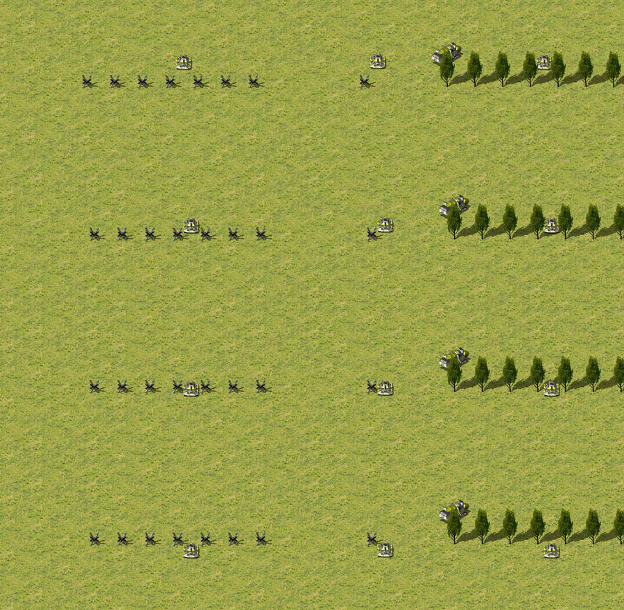

# Does RA2 let a tank cut a corner between two blockers?

Issue #18, part of the map in #1. Follows up the open question in [ra2-locomotion.md](ra2-locomotion.md) §6.

## Answer

**Yes.** A Rhino takes a diagonal step between two cells even when both orthogonal neighbours are blocked, by buildings or by trees. With one neighbour blocked it keeps its straight diagonal line too. RA2 refuses no corner-cutting diagonals, so for [ADR 0005](../adr/0005-ra2-cell-locomotion.md) the flag goes to "allow".

*Frames 0.1 s apart. Left: lane A, a row of barricades that leaves only diagonal gaps; the Rhino drives straight through between the 4th and 5th barricade. Middle: lane B, one barricade beside the path; the Rhino passes it without stepping aside. Right: lane C, the same row made of trees; the Rhino drives between the 4th and 5th tree, and no tree is shot. (The MCV at the left end of the trees is the player's start unit.)*

## Test

`tools/corner-cut-test/corner_cut_test.py` writes the map and runs it. It needs no Final Alert 2.

- **Map.** A flat 50×50 temperate map. `[IsoMapPack5]` holds tile 0 at level 0 everywhere, packed as a literal-only LZO1X stream. It has four lanes side by side. Each Rhino's route runs straight down the screen, so every step is an iso diagonal `(x+1, y+1)`; that step's orthogonal neighbours are `(x+1, y)` and `(x, y+1)`.
  - **A:** a row of `CABARR01` (1×1 neutral barricade, 1000 HP) at `x + y = const`. Neighbouring cells in the row touch only at corners, so the only way through is a diagonal step between two blocked cells.
  - **B:** one `CABARR01` on one orthogonal neighbour of the path.
  - **C, D:** as A and B, with `TREE01`.
- **No clicking.** At game start a trigger reinforces one Rhino per lane (action 80, team house `<Player @ A>`, the pattern YR's own co-op maps use). Each team's script is `3,<waypoint>`, "Move to waypoint", which sends the Rhino to a waypoint 9 rows below the wall. Action 16 reveals the map; action 112 centres the camera.
- **Launch.** It launches through the CnCNet spawner with the client's own command line (`Syringe.exe -i=Ares.dll -i=CnCNet-Spawner.dll -i=Phobos.dll gamemd-spawn.exe --args="-SPAWN ..."`), windowed at 1920×1080. `spawn.ini` pins the human to start location A, because `<Player @ A>` means "whoever starts at waypoint 0". The script backs up `spawn.ini`, `spawnmap.ini`, `RA2MD.ini` and `ddraw.ini` and restores them afterwards.
- **Recording.** ffmpeg `gdigrab` records the desktop region of the window at 10 fps. Capturing by window title gives a white frame, because DirectDraw surfaces aren't readable that way.

Run 2026-10-25 on the owner's install, twice, with the same result both times.

## Caveats

- **Modified engine.** The client injects Ares and Phobos, so this is YR 1.001 with those extensions, not bare `gamemd.exe`. Neither documents any change to the per-step passability test. [Inf]
- **Lane D wasn't recorded.** The mouse cursor at the window edge scrolled the view, which kept lane D out of frame in both runs. Lane D is implied by the other lanes: if the step is allowed with both neighbours blocked (C), it is allowed with one.
- **Not tested:** the route was given by a team script, not a player click. Both go through the same move mission and pathfinder. [Inf] Walls (overlays), cliffs and water as blockers were also not tested; walls would need `[OverlayPack]` (LCW). Tanks in the neighbouring cells were out of scope.
- **Trees weren't shot.** That fits the Rhino not needing to fire when the diagonal step is open. It doesn't show whether it would shoot a tree that fully blocks its way.

## Sources

- The in-game test above.
- YR `rulesmd.ini` (from `expandmd01.mix`) and `artmd.ini` (from `ra2md.mix` → `localmd.mix`): `CABARR01` is `Foundation=1x1`, `Strength=1000`.
- YR co-op maps `c2s01md.map` and `c1a01md.map` (in `multimd.mix` / `expandmd01.mix`): the `<Player @ X>` team-house syntax, reinforcement action 80 and script action 3.
- Final Alert 2 YR as installed (`FAData.ini`, `FinalAlert2YR.exe` strings): action 16 "Reveal all map", 80 "Reinforcement (team) [at waypoint]", 112 "Center (Jump) Camera at Waypoint", script action 3 "Move to waypoint".
- Install `Resources/ClientDefinitions.ini`: the CnCNet client's launch line.
- [Ares docs: reinforcements and multiplayer map triggers](https://ares-docs.readthedocs.io/zh-cn/latest/bugfixes/type2/reinforcementsandmultiplayermaptriggers.html): the `Player@X` trigger logic.
