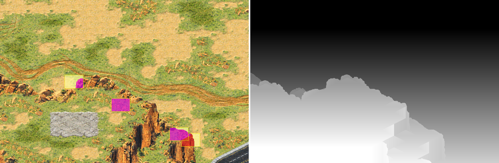

# How RA2 draws a unit moving between height levels

Issue #141, extended by #151 (§3 "The keys and their defaults", "What the comparison works out to" and the sections after it). Follows [hills-sprint-cliff-occlusion.md](hills-sprint-cliff-occlusion.md) (#140), [ra2-locomotion.md](ra2-locomotion.md) §1 and §4, [ra2-low-bridge-offset.md](ra2-low-bridge-offset.md) and [ADR 0002](../adr/0002-pixijs-with-prerendered-voxels.md).

## Tags

- **[Asm]**: read from the install's own `gamemd.exe` (YR 1.001, `D:\GAMES\Origin\...\gamemd.exe`), disassembled with Capstone. Addresses are gamemd virtual addresses. Static tables were rebuilt by stepping the initializer code by hand. The unmodified file on disk was read, so Ares and Phobos patches are not included.
- **[YRpp]**: the reverse-engineered YR headers, [Phobos-developers/YRpp@9c34873](https://github.com/Phobos-developers/YRpp/tree/9c348736f6dd783db1f123080d97d71ad1f48871). These give names and addresses. They do not show behaviour.
- **[Phobos]**: [Phobos-developers/Phobos@afe5b84](https://github.com/Phobos-developers/Phobos/tree/afe5b8434901f37099d64c6d6f29f19cf099d73f), a YR engine extension. The owner's test client injects Phobos 0.4.0.2.
- **[TS++]**: the Tiberian Sun headers in Vinifera ([Vinifera-Developers/Vinifera@2aae2e7](https://github.com/Vinifera-Developers/Vinifera/tree/2aae2e722bfc17ac76ea21434dafc2ab838bde64), submodule `TSpp@8f54442`). TS is the engine RA2 is built on.
- **[vera20k]**: [YuriPlanet/vera20k@c150b75](https://github.com/YuriPlanet/vera20k/tree/c150b7591f012de01c4477431a097df59144cd4d), a GPLv3 Rust re-implementation of YR (home page [vera20k.org](https://vera20k.org/)). Its source comments cite gamemd addresses from Ghidra. It is a re-implementation, so each vera20k claim below says whether [Asm] agrees with it.
- **[Code]**: this repo at `5f6a42e`. Material added for #151 reads it at `a591646`.
- **[Install]**: data read from the install (`rulesmd.ini`, `Hills.mmx` and its TMPs) through the repo's own readers (#151).
- **[Ares]**: [Ares-Developers/Ares@4f1d929](https://github.com/Ares-Developers/Ares/tree/4f1d929920aca31924c6cd4d3dfa849daa65252a) and its docs.
- **[Inf]**: inference, not checked in game.

Every [YRpp], [Phobos] and [vera20k] link below points at the commit named above.

## Answer

RA2 handles a unit changing height in four separate ways. Rhino Race does none of them in the same way.

1. **Height is continuous.** A ground vehicle's Z is the cell's floor height at its exact lepton position. On a ramp cell that height comes from a per-ramp-type plane equation. While a tank climbs a ramp it therefore rises smoothly, 104 leptons (15 px) per cell. It never jumps a whole level at once. **[Asm]**, and vera20k agrees value for value.
2. **The voxel tilts with the slope.** The Drive locomotor reads the slope type of the cell the unit's centre is in. It draws the hull and turret through one of 21 precomputed ramp matrices. When the slope type changes, it blends from the old tilt to the new one over 3 game frames. **[Asm]**, and YRpp, Phobos and vera20k agree.
3. **Terrain hides units with a per-pixel Z-buffer, not by draw order.** Tiles write their TMP Z data into a 16-bit Z-buffer. Units test against that buffer, so higher terrain in front of a unit hides the unit's pixels. The engine also deliberately pushes a unit behind a cliff further back: by `2 × ZFudgeCliff` when the cell at (x+1, y+1) stands 4 or more levels higher, and by `1 × ZFudgeCliff` when the cell at (x+2, y+2) does. `ZFudgeCliff` is 10 for every unit in the stock rules. **[Asm]** for the tile formula, the cliff term and the defaults (#151). **[vera20k]** for how a unit's own Z is seeded row by row.
4. **Shadows.** Ground vehicles draw a voxel shadow at their own position. The shadow point drops by the unit's height above ground, which is zero for a tank that is driving. The shadow goes through the locomotor's shadow matrix, which reads the same slope state. **[Asm]** and **[Phobos]**.

Today Rhino Race snaps the drawn level to the cell's base level at the halfway point, draws no tilt and no tank shadow, and sorts terrain only as one flat layer under the tanks. Since #140 it draws a house-colour silhouette where higher ground lies in front of a tank. RA2 hides the tank there instead. The gap list is in "What this means for us".

## 1. Vertical placement on ramps and slopes

### The floor-height function

`CellClass::GetFloorHeight(Point2D subcoords)` is at `0x47B3A0` and `MapClass::GetCellFloorHeight(CoordStruct)` is at `0x578080` ([YRpp `CellClass.h` L185](https://github.com/Phobos-developers/YRpp/blob/9c348736f6dd783db1f123080d97d71ad1f48871/CellClass.h#L185), [`MapClass.h` L330](https://github.com/Phobos-developers/YRpp/blob/9c348736f6dd783db1f123080d97d71ad1f48871/MapClass.h#L330)). From the disassembly **[Asm]**:

- `0x578080` takes the cell at `(X >> 8, Y >> 8)` and passes the full lepton X and Y to `0x47B3A0`.
- `0x47B3A0` computes `base = Level × 104` (Level is signed byte `+0x11B`; 104 is `LevelHeight`, [YRpp `Fundamentals.h`](https://github.com/Phobos-developers/YRpp/blob/9c348736f6dd783db1f123080d97d71ad1f48871/Fundamentals.h#L20)). If `SlopeIndex` (`+0x11C`) is non-zero, it reads a 5-double record from the table at `0x81C900 + (slope − 1) × 40`. It then takes the sub-cell position `x = X & 0xFF`, `y = Y & 0xFF` and returns

  `floor = base + clamp(104·(a·x + b·y)/256 + c + d, 0, max)`

  The table is filled lazily on the first call (`0x47B3ED–0x47BA94`). Stepping that initializer gives the following, with x and y the lepton offsets inside the cell (0..255) and L = 104:

| Slope | Plane before clamp | Max | Shape |
|---|---|---|---|
| 1 | L·x/256 | L | rises toward +x |
| 2 | L·y/256 | L | rises toward +y |
| 3 | L − L·x/256 | L | rises toward −x |
| 4 | L − L·y/256 | L | rises toward −y |
| 5 | L·(x+y)/256 − L | L | one corner up (outer corner) |
| 6 | L·(y−x)/256 | L | " |
| 7 | L − L·(x+y)/256 | L | " |
| 8 | L·(x−y)/256 | L | " |
| 9 | L·(x+y)/256 | L | three corners up (inner corner) |
| 10 | L + L·(y−x)/256 | L | " |
| 11 | 2L − L·(x+y)/256 | L | " |
| 12 | L + L·(x−y)/256 | L | " |
| 13 | L·(x+y)/256 | 2L | steep: far corner 2 levels up |
| 14 | L + L·(y−x)/256 | 2L | " |
| 15 | 2L − L·(x+y)/256 | 2L | " |
| 16 | L + L·(x−y)/256 | 2L | " |
| 17–20 | constant L/2 | L/2 | double ramps: flat half level |

vera20k's `ground_slope_records` and `ground_height_with_level_height` ([`src/util/lepton.rs` L150–L237](https://github.com/YuriPlanet/vera20k/blob/c150b7591f012de01c4477431a097df59144cd4d/src/util/lepton.rs#L150-L237)) cite the same `0x47B3A0`. They hold the same 21 records and clamp the same way, so they **agree** with the table.

The 21 slope types and their names are in [TS++ `tibsun_defines.h` `TileRampType`](https://github.com/Vinifera-Developers/TSpp/blob/8f5444216175ecb65215b4b89920c7b31741901b/src/tibsun/tibsun_defines.h#L2471-L2516). TS++ names the compass corners from the tile's own view, so the table above uses x and y instead.

### The Drive locomotor uses it every step

The Drive locomotor (vtable `0x7E7EB0`, [YRpp `DriveLocomotionClass.h`](https://github.com/Phobos-developers/YRpp/blob/9c348736f6dd783db1f123080d97d71ad1f48871/DriveLocomotionClass.h)) calls `GetCellFloorHeight` from 9 places between `0x4B1003` and `0x4B609A`. At `0x4B0FDC–0x4B101D` it sets the new coordinate's Z to the floor height plus `[0x8A07C4]` when cell flag `0x100` is set **[Asm]**. vera20k takes that flag as the bridge flag and gives the bridge deck as 416 leptons, or 4 levels ([`src/util/lepton.rs` `BRIDGE_DECK_HEIGHT_LEPTONS`](https://github.com/YuriPlanet/vera20k/blob/c150b7591f012de01c4477431a097df59144cd4d/src/util/lepton.rs#L145); [`src/app/presentation/instances/foot_depth.rs` L15–L26](https://github.com/YuriPlanet/vera20k/blob/c150b7591f012de01c4477431a097df59144cd4d/src/app/presentation/instances/foot_depth.rs#L15-L26)). YRpp instead calls `0x100` `BridgeHead` and marks it as unsure ([`GeneralDefinitions.h` L708](https://github.com/Phobos-developers/YRpp/blob/9c348736f6dd783db1f123080d97d71ad1f48871/GeneralDefinitions.h#L708)). The two sources disagree on the name. Bridge-deck placement itself is covered in [ra2-low-bridge-offset.md](ra2-low-bridge-offset.md) and the bridge notes.

So a tank driving up a slope-1 ramp in +x rises linearly from `Level × 104` to `(Level + 1) × 104` across the cell. On screen that is 15 px per level ([ra2-locomotion.md](ra2-locomotion.md) §1: 60×30 cells, 104 leptons per level). **[Asm]** On outer and inner corner ramps the clamp folds the plane, so part of the cell is flat. **[Asm]**

## 2. Tilt: the voxel leans on slopes

- `ILocomotion::Draw_Matrix` and `Shadow_Matrix` are virtual methods of the locomotor ([YRpp `Interfaces.h` L193–L202](https://github.com/Phobos-developers/YRpp/blob/9c348736f6dd783db1f123080d97d71ad1f48871/Interfaces.h#L193-L202)). Drive overrides both: in its ILocomotion vtable slot 9 is `0x4AFF60` and slot 10 is `0x4B0410` **[Asm]**.
- **Process** (`0x4B0500`) reads the `SlopeIndex` of the cell the unit is in (`+0x11C`). If it differs from `CurrentRamp`, it sets `PreviousRamp = CurrentRamp` and `CurrentRamp = SlopeIndex`, then starts `SlopeTimer` at 3 frames (`push 3` at `0x4B052D`). **Unlimbo** (`0x4B04D0`) snaps both fields to the cell's slope through `Force_New_Slope`. **[Asm]** vera20k [`src/sim/movement/slope_transition.rs` L1–L80](https://github.com/YuriPlanet/vera20k/blob/c150b7591f012de01c4477431a097df59144cd4d/src/sim/movement/slope_transition.rs#L1-L80) describes the same behaviour (`SLOPE_TRANSITION_FRAMES = 3`, citing the same addresses) and **agrees**.
- **Draw_Matrix** (`0x4AFF60`) works in two ways **[Asm]**:
  - While the timer runs, it calls `0x755A40(prev, cur, progress)`. That function slerps between two quaternions from the table at `0xB43188` and converts the result to a matrix (`0x646590`, `0x646980`).
  - Otherwise it copies `VoxelRampMatrix[CurrentRamp]` (`0x7559B0`, the table at `0xB45188`, [YRpp `Matrix3D.h` L332](https://github.com/Phobos-developers/YRpp/blob/9c348736f6dd783db1f123080d97d71ad1f48871/Matrix3D.h#L332)).
  - In both cases it also folds in the unit's rocking angles (`AngleRotatedForwards` and `AngleRotatedSideways`, `+0x328` and `+0x32C`).
  - The ramp type goes into the voxel cache key. YRpp's `MainVoxelIndexKey` gives `RampType : 6` with "Drive : Loco->Ramp" ([`Drawing.h` L451–L485](https://github.com/Phobos-developers/YRpp/blob/9c348736f6dd783db1f123080d97d71ad1f48871/Drawing.h#L451-L485)). This means the game renders and caches one hull image per (facing, ramp) pair.
- **How far it leans.** vera20k's copy of the quaternion table ([`src/map/voxel_slope.rs` L1–L135](https://github.com/YuriPlanet/vera20k/blob/c150b7591f012de01c4477431a097df59144cd4d/src/map/voxel_slope.rs#L1-L135)) gives these vanilla angles:
  - about 29.4° on straight ramps 1–4,
  - about 21.4° on corners 5–12,
  - about 29.4° on steep ramps 13–16,
  - 0° on 17–20.

  The real ground slope is atan(104/256) ≈ 22.1°. Phobos says vanilla over-tilts straight ramps. It patches the angle pushed at `0x75546D`, `0x755484`, `0x7554A1`, `0x7554BE`, `0x755656`, `0x755677`, `0x755698` and `0x7556B9` from `ebx` to `ebp`, which is atan(104/256) ([`Hooks.MatrixOp.cpp` L1128–L1150](https://github.com/Phobos-developers/Phobos/blob/afe5b8434901f37099d64c6d6f29f19cf099d73f/src/Ext/TechnoType/Hooks.MatrixOp.cpp#L1128-L1150); changelog: "Fixed an issue that units on the slope tilted at an excessive angle", 0.4). The vanilla `push ebx` at `0x75546D`, before `Matrix3D(rotate_z, rotate_x)` (`0x5AE6F0`), was confirmed in [Asm]. The installed `Phobos.dll` 0.4.0.2 contains patches at `0x75546D` and `0x755484`. **So the owner's client tilts straight ramps by about 22°, while unpatched YR tilts them by about 29°.**
- `UnitType` has an `IsTilter` field (`Tilter=` in the exe's strings), and `Rules` has `TiltFrames` ([YRpp `UnitTypeClass.h` L67](https://github.com/Phobos-developers/YRpp/blob/9c348736f6dd783db1f123080d97d71ad1f48871/UnitTypeClass.h#L67), [`RulesClass.h` L48](https://github.com/Phobos-developers/YRpp/blob/9c348736f6dd783db1f123080d97d71ad1f48871/RulesClass.h#L48)). Whether `Tilter=no` turns slope tilt off for Drive units was not traced.

## 3. What covers a unit: draw order plus a Z-buffer

### Layers and painter order

Objects are drawn in layers and sorted by `GetYSort` ([YRpp `ObjectClass.h` L107](https://github.com/Phobos-developers/YRpp/blob/9c348736f6dd783db1f123080d97d71ad1f48871/ObjectClass.h#L107); the layer rules are in the `GeneralDefinitions.h` comment at L912ff, where Drive is `Ground`). TS draws the tile surface together with the Z-buffer and A-buffer first. Buildings, overlays and smudges come next, then anims, terrain objects and units ([TS++ `tactical.h` `RenderPassEnum`](https://github.com/Vinifera-Developers/TSpp/blob/8f5444216175ecb65215b4b89920c7b31741901b/src/tactical.h#L27-L32)). **[TS++]**, assumed the same in YR.

### The Z-buffer

- YR keeps one 16-bit Z value per screen pixel in `ZBuffer::Instance` at `0x887644`, next to `ABuffer` at `0x87E8A4` ([YRpp `Drawing.h`](https://github.com/Phobos-developers/YRpp/blob/9c348736f6dd783db1f123080d97d71ad1f48871/Drawing.h)). The buffer is a ring buffer that scrolls with the camera ([Vinifera `zbuffer_window.cpp` L86–L94](https://github.com/Vinifera-Developers/Vinifera/blob/2aae2e722bfc17ac76ea21434dafc2ab838bde64/src/debug/zbuffer_window.cpp#L86-L94)).
- A blitter with Z read draws a pixel only where its Z is lower than the stored value (lower is nearer). A blitter with Z write also stores the new Z. When a Z-shape is in use, each pixel's Z is `z_min − zshape[pixel]` ([Vinifera `blitter_simd.h` L63–L64](https://github.com/Vinifera-Developers/Vinifera/blob/2aae2e722bfc17ac76ea21434dafc2ab838bde64/src/extensions/blitter/blitter_simd.h#L63-L64), [`blitter_simd_impl.h` L869–L881](https://github.com/Vinifera-Developers/Vinifera/blob/2aae2e722bfc17ac76ea21434dafc2ab838bde64/src/extensions/blitter/blitter_simd_impl.h#L869-L881)). Vinifera's blitters are written to be bit-exact with TS's. **[TS++]**
- **Tiles write their TMP Z data.** In gamemd, 260 instructions reference `0x887644`. One group sits in the isometric-tile blitter at `0x547E00–0x5496D6`. That code checks the TMP image header's has-Z-data flag (`test byte [edi+0x24], 2`, `0x548228`) and takes the pointer at header `+0x0C` (`ZDataOffset`, as laid out in [TS++ `IsoTileImageStruct`](https://github.com/Vinifera-Developers/TSpp/blob/8f5444216175ecb65215b4b89920c7b31741901b/src/tibsun/tibsun_defines.h#L2699-L2718)). It then writes 16-bit words into the Z-buffer row by row. **[Asm]**
- **The tile formula, checked in [Asm] (#151).** At `0x547F63–0x547F97` the blitter stores
  `base = (u16)(ZBuffer[+0x24] + ZBuffer[+4] − y − tileH) − tileH × level / 2`
  in `[0xAA1104]`. `tileH` is `[edi+0xC]`, the template's tile height (30). vera20k names `+0x24` as `DefaultZ = 0x8000` and `+4` as the buffer's `YOrigin` ([`native_z.rs` L14–L32](https://github.com/YuriPlanet/vera20k/blob/c150b7591f012de01c4477431a097df59144cd4d/src/render/native_z.rs#L14-L32), `tile_base_z` at L335–L344). Those two names are [vera20k]; the arithmetic is [Asm].
  - The diamond loop at `0x5487A0–0x5487B6` computes `z = base + zdata[i]` (`movzx` of one Z-data byte, `add`). It skips the pixel when `zbuf < z` (`cmp word [ecx], ax; jb`). Otherwise it stores `z` in the Z-buffer and draws the colour. So a tile pixel is drawn and written where `base + zdata ≤ zbuf`. Lower Z is nearer.
  - The cliff overhang (`extra` art) has a second loop at `0x549323–0x5493E4`. It takes its Z bytes from header `+0x10` (`ExtraZDataOffset`, row stride `+0x1C` = extra width) and adds the **same** `base`. It tests only pixels whose colour byte is non-zero. **[Asm]**
- **Units test against it.** `CC_Draw_Shape` and `BitBlit` take a `ZAdjust` ("+1 = sqrt(3) px away from screen") and a `ZGradient` ([YRpp `Surface.h` L160–L172](https://github.com/Phobos-developers/YRpp/blob/9c348736f6dd783db1f123080d97d71ad1f48871/Surface.h#L160-L172)).
  - Seen in [Asm]: the unit's final composite (`0x73B140`) is blitted through `Standard_SHP_blitter` (`0x4373B0`, call at `0x73B3E5`). Its arguments include `push 2`, the ZGradient, and the result of vtable `+0x2EC` as ZAdjust. In UnitClass's vtable (`0x7F5C70`) that slot is `0x4DAFC0`, `FootClass::GetZAdjustment`. A second path (`0x73B335–0x73B343`) passes gradient 0 and `GetZAdjustment() − 5`. vera20k calls that path the bridge split, where the top part of a tall unit uses gradient 0 and its last 16 rows use gradient 2.
  - Only from vera20k: gradient 2 is seeded at the bottom row of the blit rectangle and grows by 1 every 3 rows going down, so it is an upright billboard. `GetZAdjustment` starts from `−AdjustForZ(Location.Z)` (native_z.rs L25–L31, L96–L125). The same file at L3–L7 says that every draw tests the buffer, and that only buildings and tiles write to it. **[vera20k]**

### The cliff fudge

`FootClass::GetZAdjustment` (`0x4DAFC0`) returns the sum of three parts **[Asm]**:

- the locomotor's `Z_Adjust`, which is 0 for Drive (`0x4B4870`: `xor eax,eax`);
- the largest of `ZFudgeColumn × column`, `ZFudgeTunnel × tunnel`, `ZFudgeCliff × cliff`, and `ZFudgeBridge` when near a bridge (`0x4DB003–0x4DB088`: three `imul`s against the type's `+0xDC4`, `+0xDC8` and `+0xDC0`, then a running signed max). The bridge candidate is 0 when the unit is not near a bridge, so the max is never negative;
- a terrain term from `0x704350`.

The cliff score comes from `0x704240` **[Asm]**:

- It looks at the cell one step along direction 3 from the unit's cell. Direction 3 comes from the table at `0x89F688`, entry `+0xC`, which is (+1, +1), the cell toward the camera. If that cell's `Level` is 4 or more above the unit's own, the score is 2.
- It then looks one step further. If that cell is 4 or more levels higher, the score is 1 and replaces the first result.
- On a bridge (`+0x8C` set) the score is 0.

Re-read for #151 (`0x704240–0x70433C`): the unit's cell is the cell of its coordinate (vtable `+0x1B8`), the two levels compared are signed bytes `+0x11B`, and the test is `sub; cmp 4; jl`, so "4 or more levels higher". The second sample really does replace the first: a cliff at (x+1, y+1) alone scores 2, and a cliff at (x+2, y+2) scores 1 whatever (x+1, y+1) is. The fudge is therefore `2 × ZFudgeCliff` = 20 directly behind a cliff and `1 × ZFudgeCliff` = 10 one cell further back, or behind a cliff two cells deep. **[Asm]**

**The keys and their defaults, verified (#151).**

- `ZFudgeCliff`, `ZFudgeColumn`, `ZFudgeTunnel` and `ZFudgeBridge` are TechnoType fields `+0xDC0`, `+0xDC4`, `+0xDC8` and `+0xDCC` ([YRpp `TechnoTypeClass.h` L517–L520](https://github.com/Phobos-developers/YRpp/blob/9c348736f6dd783db1f123080d97d71ad1f48871/TechnoTypeClass.h#L517-L520)).
- **Defaults [Asm].** The TechnoType constructor (`0x710AF0`, [YRpp L179](https://github.com/Phobos-developers/YRpp/blob/9c348736f6dd783db1f123080d97d71ad1f48871/TechnoTypeClass.h#L179)) sets `ebx = 0` at `0x710B00` and `edi = 10` at `0x710BF3`, and changes neither before `0x711664–0x71167A`. There it stores cliff = `edi` = **10**, column = **5**, tunnel = `edi` = **10** and bridge = `ebx` = **0**. vera20k's defaults ([`src/render/foot_depth.rs` L86–L97](https://github.com/YuriPlanet/vera20k/blob/c150b7591f012de01c4477431a097df59144cd4d/src/render/foot_depth.rs#L86-L97)) **agree**.
- **Where they're read [Asm].** All four are read at `0x715423–0x7154A0` inside `TechnoTypeClass::LoadFromINI`. That function runs from `0x712170` to `0x716132`; Ares hooks its end at `0x716123`/`0x716132` as `TechnoTypeClass_LoadFromINI`, as listed in Phobos's [Ares hook list](https://github.com/Phobos-developers/Phobos/blob/afe5b8434901f37099d64c6d6f29f19cf099d73f/.agents/skills/check-hooks/ares_3.0p1_hooks.cpp). They are read with `ReadInteger` (`0x5276D0`) from the INI passed in, under the type's own section. So they are **per-type rules keys** (rules(md).ini and map overrides), not `[AudioVisual]` keys and not art keys.
- **The install's values [Install].** `rulesmd.ini`, as the repo's VFS serves it, documents them at L3667–L3671: "WST 6/23/99. Below are new zbuffer adjustment for units … ZFudgeCliff // fudge for units behind cliffs showing through rocks". No section in `rulesmd.ini` or `rules.ini` sets `ZFudgeCliff`. `[HTNK]` (L7683) sets only `ZFudgeColumn=8` and `ZFudgeTunnel=13` (L7725–L7726). So a Rhino uses **cliff 10**, column 8, tunnel 13 and bridge 0. `artmd.ini` has no `ZFudge` keys.

A positive ZAdjust pushes the unit away from the screen. The rules comment states the intent: without the fudge, units "behind cliffs" show "through rocks". **So a unit standing directly behind a cliff 4 or more levels high is pushed further behind it, and the cliff face reliably covers it.** **[Asm]** and **[Install]** for the sign and the intent. It has not been seen in game.

The terrain term `0x704350`, as vera20k describes it at L268–L318, is 2 near rocks on a ramp and −1 or −2 otherwise. It depends on ramps and on tile heights over 36 px around the unit. **[vera20k]** Only the call was seen in [Asm]; the body was not read.

### What the comparison works out to (#151)

**Terrain side [Asm] plus arithmetic.** Call the tile's drawn top row `top`, so it is already lifted by its level. Its pixels get `Z = 0x8000 − (top + 30 + 15·level − zdata)`, leaving out the camera's `YOrigin`. Define the nearness as `D = top + 30 + 15·level − zdata`, so `Z = 0x8000 − D`. A larger D is nearer.

**Hills' TMP Z data [Install]**, read with the repo's `TmpFile` in a throwaway probe:
- The diamond Z data is the same ramp in **12,609 of 12,720** cells: every pixel in diamond row r (0 = top) holds `29 − r`. For a flat pixel, D therefore reduces to `drawn row + 15·level + 1`. That is the pixel's ground-projected screen row: where it would sit at level 0.
- The other **111** cells are cliff tiles whose upper diamond half is flat at 15. That makes the upper half a vertical face.
- The cliff overhangs carry the real shape in their `ExtraZData`. Down each pixel column the value stays constant (a vertical wall). Across the columns it runs from 15 to 29 and back as the face recedes diagonally. Examples: `cliff18.tem` sub 1 at (74, 59), and `cliff23`, `cliff27`, `cliff28` and `cliff37` around the two #140 spots.
- `src/ra2/tmp/tmpFile.ts` reads the header offset `extraZOfs` (L37) but never reads that data.

**Unit side, partly [vera20k].**
- Take a flat-ground unit at level `L`, with its blit rectangle's bottom row at screen row `B`. Its nearness at row `r` is about `D_u(r) = B + 15·L − fudge + 1 + (B − r)/3`.
  - `+1`: the flat-ground terrain term is `−1`.
  - `−fudge`: the max term above, so 0, 10 or 20 for a Rhino behind a cliff.
  - `(B − r)/3`: gradient 2, so the top of the unit is nearer than its bottom.
- On a ramp `15·L` becomes `AdjustForZ(Location.Z)`, which is continuous.
- A unit pixel is hidden where `D_terrain ≥ D_u`. Whether a tie hides the unit is unverified: the unit blitter's compare was not read.
- On open flat ground this hides nothing above the bottom row. Every terrain pixel above that row is further away than the unit. That is why the seed must sit at the unit's **bottom** row and not its centre. Seeded at the centre, flat ground in front would cut off the hull's lower half. **[Inf]** from the formulas.

**Hills, both rules side by side [Install] [Inf].** A throwaway probe rebuilt the bake with this D per pixel, keeping the nearest value as the tile pass does. It then counted the hidden pixels of a 49×35 box around each tank's draw point, with `B` = draw point + 12 rows (an assumption: the real composite rectangle was not measured). "Today" is `src/silhouette.ts:48` as it stands.

| Cell (level 2) | Fudge | Hidden, RA2 rule | Hidden, today |
|---|---|---|---|
| (72, 52) | 0 | 66% | 17% |
| (71, 52) | 10 | 86% | 79% |
| (70..63, 52) | 10 | 86–100% | 86–100%, same per cell |
| (62, 52) | 0 | 29% | 27% |
| (57, 55..58), (55, 60..64) | 10 | 77–100% | the same |
| (55, 65) | 10 | 100% | 89% |
| (55, 66) | 10 | 94% (90% without fudge) | 90% |
| open ground, controls | 0 | 3% (the box's bottom row: a tie) | 0% |

What this shows:
- **At the #140 spots the cover is the same.** The mesa is 4 to 8 levels (60 to 120 rows of D) nearer than the tank. The fudge of 10 to 20 changes nothing there, and today's whole-cell rule already hides 100% of the box on (63..68, 52) and (55, 62..64).
- **The differences are at the ends of each stretch.** At (72, 52) the cliff face of the cell in front (red in the picture) covers the tank in RA2, but today's rule misses it: the face belongs to a cell whose `x + y` key is not ahead of the tank's. Corners and partly covered cells come out different too.
- **RA2 has no level margin.** Today a cell must be 2 or more levels higher to cover the tank. In RA2 any terrain pixel nearer than the unit covers it, including a 1-level rise. This only affects pixels that actually overlap the tank sprite.

### Does anything show a hidden unit? [Asm] [Phobos] [Ares]

- **Vanilla.** The covered pixels are simply not drawn: the composite goes through one Z-tested `Standard_SHP_blitter` call (above), and nothing in `0x73B140` draws the unit a second time. A Rhino behind the mesa is therefore invisible, with no outline. This is [Asm] for that draw function only. The selection box, health bar and other overlays were not traced, and no in-game capture was taken.
- **Phobos** (docs at afe5b84: `Fixed-or-Improved-Logics.md`, `New-or-Enhanced-Logics.md`, `User-Interface.md`, `Miscellanous.md`). These docs list no behind-terrain or behind-building silhouette, X-ray or outline. Their Z features are `ZAdjust` for OverlayTypes and projectiles, `WarheadAnimZAdjust`, `EBoltZAdjust` and `LaserZAdjust`, which shift depth only. None touches `ZFudge*`.
- **Ares** ([Ares-Developers/Ares@4f1d929](https://github.com/Ares-Developers/Ares/tree/4f1d929920aca31924c6cd4d3dfa849daa65252a), [Ares-docs@7e2a509](https://github.com/Ares-Developers/Ares-docs/tree/7e2a509b731efb3a523d64a6933f2fde01903623)). GitHub code search for `ZFudge`, `ZBuffer` and `silhouette` finds nothing. The `behind` hits are unrelated: trailers, open-topped transports and a superweapon.
- So the house-colour silhouette is ours alone. Neither the game nor these two extensions has one.

### What the change needs in this repo [Code] [Inf]

1. **Bake.** In `bakeTerrain` (`src/battlefield/terrain.ts:70-77`), store the 16-bit D per pixel in the depth layer's R + G×256, in battlefield px: `oy + 30 + 15·t.z − zdata`. Hills is far below 65,536 rows. The diamond loop needs the Z byte in the expanded layout, and the `extra` loop needs `ExtraZData`. That means `TmpFile` must expand `zData` with the same diamond walk as the bitmap and read `extraZOfs`. Keep B (level + 1 today) only if something else reads it.
2. **Paint order.** RA2 keeps the nearest Z per pixel; it does not keep the last tile painted. Write D only where it is ≥ the stored value. Leave the colour on painter's order, so the bake looks the same as today. Bump `IMPORT_VERSION` (`src/install/cache.ts:6`).
3. **Shader.** `src/silhouette.ts` `hidden()`: replace the cell key and the `+2` margin with `D_t ≥ D_u(row)`. `uTank` would carry the bottom row `B`, `15·lvl` and the fudge. The shader computes `D_u = B + 15·lvl − fudge + c + (B − row)/3` from `vScreen`. `c` and `B`'s offset below the draw point are the calibration knobs: the composite rectangle's height was not measured.
4. **Fudge.** In `src/main.ts` near `v.hide(...)` (L396), score the cell that contains the centre (`Math.floor(fx)`, `Math.floor(fy)`, as RA2 does). Use 20 if `level(x+1, y+1) − level(x, y) ≥ 4`, then 10 if `level(x+2, y+2) − level(x, y) ≥ 4`, else 0. Use 0 on a deck.
5. **Fractional `floorLevel`.** It fits directly. `15 · tankLevel(...)` is what `AdjustForZ(Location.Z)` gives on a ramp, so it stays continuous with no snap. Use the level and the y **before** `hop`: RA2 adds the lift to Z and to the screen position alike, so the two cancel.

**Risks.**
- **The bottom-row seed.** If `B` sits too high, flat ground in front starts to cover the tank's lower edge on open ground. On ramps the terrain term is also `−1`, plus or minus the rock rule, so check a tank climbing (106..105, 60..54).
- **Ties.** The bottom row ties with the ground under it. Use `>` or add 1.
- **Extra Z alignment.** `ExtraZData` shares the tile's base, so the overhang's own y offset (`e.y − tile.y`) must not enter D.
- **Bridge decks.** No ramp or cliff fudge applies there (score 0). Bridge overlays are not terrain and write no D, as today.

## 4. Shadows and height above ground

- Base `LocomotionClass::Shadow_Point` (`0x55A8C0`, which Drive inherits) returns `(0, AdjustForZ(GetHeight()))`. That is a screen offset straight down by the unit's height above its floor. For a driving tank the height is 0, so the shadow sits under the tank. **[Asm]** ([YRpp `LocomotionClass.h` L60](https://github.com/Phobos-developers/YRpp/blob/9c348736f6dd783db1f123080d97d71ad1f48871/LocomotionClass.h#L60))
- Drive's `Shadow_Matrix` (`0x4B0410`) opens with the same slope-timer and rocking checks as its `Draw_Matrix`, so the shadow follows the ramp tilt. **[Asm]** for the prologue. The rest of the function was not read.
- The shadow is the voxel section `ShadowIndex`, drawn by `TechnoClass::DrawVoxelShadow` (`0x706BD0`) through `VoxelDefaultMatrix × Shadow_Matrix` at `draw point + Shadow_Point` ([Phobos `Hooks.MatrixOp.cpp` L648–L800](https://github.com/Phobos-developers/Phobos/blob/afe5b8434901f37099d64c6d6f29f19cf099d73f/src/Ext/TechnoType/Hooks.MatrixOp.cpp#L648-L800), which replaces vanilla `0x73C47A`; [YRpp `TechnoClass.h` L462](https://github.com/Phobos-developers/YRpp/blob/9c348736f6dd783db1f123080d97d71ad1f48871/TechnoClass.h#L462)). By default the turret casts no shadow (`UseTurretShadow`; Phobos `DrawTurretShadow`). **[Phobos]**
- A unit's height above ground is `Location.Z − floor`. Section 1 sets that to 0 on every step for Drive units, ramps included. Only a knockback-style hop, which RA2 doesn't have for Drive units, or a bridge deck change would lift it. **[Asm]**, with the hop part being [Inf].

## What Rhino Race does today

| Point | RA2 / YR | Rhino Race | Code |
|---|---|---|---|
| Height on a ramp | linear plane inside the cell, 15 px per level, continuous | the cell's base level: `spotLevel` of `tank.cell`, which switches at the halfway point, so the tank jumps 15 px there | `src/main.ts:379`, `src/movement/route.ts:52-55`, `src/movement/index.ts:323-326` |
| Which cell counts | the cell containing the centre (`X>>8, Y>>8`) | the cell nearest the centre, the same edge for straight moves | `src/movement/index.ts:323` |
| Tilt | ramp matrix of the containing cell, slerped over 3 frames; about 22° with Phobos, about 29° vanilla | none: 32 flat facings, one prerender | `src/assets/rhino.ts:42-50`, `src/main.ts:368-370` |
| Terrain over units | per-pixel Z-buffer from TMP Z data, plus `ZFudgeCliff` behind cliffs of 4 or more levels | terrain baked flat under all tanks. Since #140 a depth layer per pixel (cell x+y and level) turns covered tank pixels into a silhouette, only when the cover is 2 or more levels higher | `src/battlefield/terrain.ts:70-77`, `src/silhouette.ts:39-49`, `src/main.ts:388-390` |
| TMP Z data | written to the Z-buffer | parsed, not used | `src/ra2/tmp/tmpFile.ts:230-249` |
| Slope type | cell `SlopeIndex` | TMP `rampType` per cell, used for passability and the debug overlay only | `src/battlefield/grid.ts:83`, `src/movement/route.ts:62-66`, `src/main.ts:71` |
| Tank shadow | voxel `ShadowIndex` shadow under the unit, tilted with the ramp | none (only the Kirov has one) | `src/main.ts:454` |
| Bridge deck | floor + 416 leptons (4 levels) | `deck` = level + 4, and `zIndex + 60` on a deck | `src/movement/route.ts:52-55`, `src/main.ts:389` |

## What this means for us

In order of how much each changes the look, cheapest first:

1. **Ramp height** (small, no import change). Replace `spotLevel(grid, on)` in `src/main.ts:379` with a `floorLevel(grid, fx, fy)` that applies the table in §1 to `grid.level` and `grid.ramp` at the fractional cell position: `level + clamp(plane, 0, max) / 104`. Keep the deck case as it is. This removes the 15 px snap halfway up a ramp. Use the same value for `zIndex` and for the silhouette's `level` uniform (`src/main.ts:389-390`). The 2-level margin in `src/silhouette.ts:48` was added "so a ramp's next cell doesn't flicker the hull". A continuous height may let that margin shrink. **[Inf]** It depends on whether our TMP `rampType` numbering equals the engine's `SlopeIndex`. Check one ramp on Hills in the browser (open question 1).
2. **Tilt** (medium, changes the prerender, so bump `IMPORT_VERSION` in `src/install/cache.ts:6`). Prerender the hull and turret for ramp types 1–16 as well as flat: 17 × 32 frames per Rhino colour, as RA2's cache key does. Apply the ramp rotation before the facing rotation in `voxelRender`. Choose the frame from the containing cell's ramp. Optionally cross-fade over 3 ticks, since RA2 slerps over 3 frames. Atlas size grows about 17×, so it may be worth limiting the set to ramp types that actually occur on course maps. Match the owner's Phobos client (about 22°), not vanilla (about 29°).
3. **Occlusion** (open product decision from #140). RA2 hides the tank. We draw a silhouette. To match RA2 more closely, keep the silhouette but compare against the true Z instead of a flat 2-level margin:
   - take the TMP `zData` (already parsed), offset per cell like `base + zdata`, into the bake's depth layer;
   - push the tank back by `ZFudgeCliff` when (x+1, y+1) or (x+2, y+2) is 4 or more levels higher.

   Whether the silhouette stays, or is swapped for true hiding, is the operator's call from #140, not a research finding.

   #151 corrects two points. The cliff push is 20 for (x+1, y+1) and 10 for (x+2, y+2), not a flat `ZFudgeCliff`. Cliff faces need the overhang's `ExtraZData`, which we don't parse yet. The concrete steps are in §3, "What the change needs in this repo".
4. **Shadow** (medium). Render the Rhino's `ShadowIndex` section as a flattened shadow sprite under the hull, tilted with the ramp frame. This needs a shadow pass in `src/ra2/render/voxelRender.ts`. No shadow is drawn there today.

Skipped: the column, tunnel and bridge fudges and the `0x704350` terrain term. They matter only for low bridges, tunnels and weapons-factory exits, which no shipped course drives through.

## Open questions

1. ~~Does our TMP `rampType` (`src/ra2/tmp/tmpFile.ts:262`) use the same numbering as the engine's `SlopeIndex` (`CellClass +0x11C`)?~~ **Answered: yes, for types 1–12.** A one-off test checked every ramp cell on the 53 install maps (`*.mmx`, `*.yro`). For each edge to a flat, drivable neighbour 0–2 levels up, it asked which §1 plane puts both shared corners at that neighbour's level. For every `rampType` 1–12 the best fit was the same engine slope number, at 99.4–100% of 3,263–8,561 edges per type. No install map had a type 13–16 cell next to a flat neighbour, so the steep ramps are untested; the double ramps 17–20 have no clean corners and were skipped. YRpp's "this + 2 == … PLACE.SHP" comment ([`CellClass.h` L465](https://github.com/Phobos-developers/YRpp/blob/9c348736f6dd783db1f123080d97d71ad1f48871/CellClass.h#L465)) is about a different index. **[Inf]** from the install's map geometry, not from the code that fills `SlopeIndex`.
2. In game, is a Rhino at (66, 52) or (55, 63) on Hills hidden by the mesa (#140)? The code says yes, but no capture was taken for this issue. That needs a Syringe run like the low-bridge test.
3. Does `Tilter=no` (or the Rhino's own art and rules) turn off slope tilt for Drive units? Not traced. (`[HTNK]` has `IsTilter=yes`.) ~~Are `ZFudge*` read from `rulesmd` or `artmd`, and does `[HTNK]` set any?~~ **Answered (#151):** they are per-type rules keys, and `[HTNK]` sets column 8 and tunnel 13 but not cliff (§3).
4. The exact Z seed of a voxel unit (bottom-row seed, the `/3` gradient walk) comes from vera20k only. #151 confirmed in [Asm] that the unit composite is blitted with gradient 2 and `GetZAdjustment()`. The seed arithmetic inside `Standard_SHP_blitter` (`0x4373B0`), the composite rectangle's size, and whether the unit's compare is strict were not read.
## Not verified from primary sources

- ~~The per-pixel tile Z formula~~: now [Asm] (#151). Only the names `DefaultZ = 0x8000` and `YOrigin` for ZBuffer `+0x24` and `+4` are [vera20k], and they cancel out of any comparison.
- The unit Z seed: bottom row, `(B − r)/3`, the `−1`/`−2` terrain term, and whether ties hide. These are [vera20k]. The gradient-2 blit with `GetZAdjustment` is [Asm].
- The size of the unit's composite blit rectangle, which places `B`. Not measured; the #151 probe assumed draw point + 12 rows.
- The vanilla tilt angles of about 29.4° and 21.4°. These come from vera20k's dumped quaternion table and Phobos's comment. [Asm] only confirmed the instruction that Phobos patches.
- ~~The `ZFudge` defaults other than column = 5~~: now [Asm] (cliff 10, column 5, tunnel 10, bridge 0) and [Install] (`[HTNK]` column 8, tunnel 13).
- That vanilla draws no outline for a hidden unit. This is [Asm] for `0x73B140` only; other overlay passes were not traced.
- The name of cell flag `0x100` (bridge deck in vera20k, `BridgeHead` in YRpp). They disagree.
- Every visual consequence (a tank hidden behind a mesa, shadow tilt). None was checked in game. The #151 hidden percentages are a model, not a capture.

## Decision points (#151)

These are for the operator. The facts above inform them; they are not findings.

1. **Silhouette or true hiding.** Vanilla RA2/YR hides the covered pixels outright, with no outline. Neither Phobos nor Ares adds one. With RA2's rule, a Rhino on (63..68, 52) and (55, 62..64) on Hills is 100% covered for several cells in a row, and 77–100% on the cells around them.
   - True hiding matches the game, but the racer vanishes on stream. The name tag is drawn above everything (`tags`) and would still show.
   - The silhouette keeps the racer readable, but no RA2 viewer has seen it in the game.
   - Either works with the same depth test. Only the shader's output for a hidden pixel differs.
2. **Is the Z port worth it at these spots?** At the #140 spots the new rule hides the same share as today's. It changes the ends of each stretch, for example (72, 52) at 66% against 17%, cliff faces seen from the side, and 1-level rises.
   - The port is: a parser change for `ExtraZData`, a new depth encoding, an `IMPORT_VERSION` bump, and a calibrated `B`.
   - Keeping today's rule costs nothing, but cliff faces stay wrong at the edges.
3. **Calibration against the game.** One in-game capture of a Rhino at (72, 52) and (66, 52) would fix `B` and the tie rule, as the Syringe low-bridge test did. Without it, the per-pixel edge is a model.

## Sources

- `gamemd.exe` from the install, disassembled with Capstone 5.0.7:
  - floor height: `0x47B3A0` (with table `0x81C900` and its initializer `0x47B3ED–0x47BA94`), `0x578080`;
  - Drive locomotor: vtable `0x7E7EB0`, `0x4AFF60`, `0x4B0410`, `0x4B04D0`, `0x4B0500`, `0x4AFB00`, `0x4AFB40`, `0x4B0FDC–0x4B101D`, `0x4B4870`;
  - ramp matrices: `0x7559B0`, `0x755A40`, `0x75545F–0x755478`;
  - locomotor shadow point: `0x55A8C0`;
  - depth: `0x4DAFC0`, `0x704240`, tile blitter `0x547E00–0x5496D6`, TechnoType constructor `0x711664`;
  - INI key strings `ZFudge*`, `Tilter`, `TiltFrames`, `UseTurretShadow`;
  - #151: tile base `0x547F63–0x547F97`, diamond Z loop `0x5487A0–0x5487B6`, extra Z loop `0x549323–0x5493E4`, cliff score `0x704240–0x70433C`, `0x4DAFC0–0x4DB09E`, TechnoType constructor `0x710AF0` (`0x710B00`, `0x710BF3`, `0x711664–0x71167A`), `TechnoTypeClass::LoadFromINI` `0x712170` (`ZFudge*` at `0x715423–0x7154A0`, strings `0x8434F8–0x843528`), unit composite `0x73B320–0x73B3E5`, UnitClass vtable `0x7F5C70` slot `+0x2EC`.
- Install data (#151), read through the repo's VFS: `rulesmd.ini` L3667–L3671 and `[HTNK]` L7683–L7726, `rules.ini`, `artmd.ini`. `Hills.mmx` TMP Z data and extra Z data read with `TmpFile` in throwaway probes (deleted).
- Ares-Developers/Ares @ 4f1d929 and Ares-docs @ 7e2a509 (GitHub code search). Phobos @ afe5b84: `.agents/skills/check-hooks/ares_3.0p1_hooks.cpp`, `docs/*.md`. YRpp: `CCINIClass.h`, `UnitClass.h`.
- The install's `Phobos.dll` (0.4.0.2): patch addresses found by byte search.
- YRpp @ 9c34873: `CellClass.h`, `MapClass.h`, `DriveLocomotionClass.h`, `LocomotionClass.h`, `Interfaces.h`, `Drawing.h`, `Matrix3D.h`, `Surface.h`, `TechnoClass.h`, `TechnoTypeClass.h`, `UnitTypeClass.h`, `RulesClass.h`, `ObjectClass.h`, `GeneralDefinitions.h`, `Fundamentals.h`.
- Phobos @ afe5b84: `src/Ext/TechnoType/Hooks.MatrixOp.cpp`, `docs/Fixed-or-Improved-Logics.md` L201, `docs/Whats-New.md` L2959.
- Vinifera @ 2aae2e7 with TSpp @ 8f54442: `src/extensions/blitter/blitter_simd.h`, `blitter_simd_impl.h`, `src/debug/zbuffer_window.cpp`, `TSpp/src/tactical.h`, `TSpp/src/tibsun/tibsun_defines.h`, `TSpp/src/locomotors/drivelocomotion.h`.
- vera20k @ c150b75: `src/util/lepton.rs`, `src/map/voxel_slope.rs`, `src/sim/movement/slope_transition.rs`, `src/render/native_z.rs`, `src/render/foot_depth.rs`, `src/app/presentation/instances/foot_depth.rs`.
- This repo @ 5f6a42e: `src/main.ts`, `src/movement/index.ts`, `src/movement/route.ts`, `src/battlefield/terrain.ts`, `src/battlefield/grid.ts`, `src/silhouette.ts`, `src/ra2/tmp/tmpFile.ts`, `src/assets/rhino.ts`, `src/install/cache.ts`.
