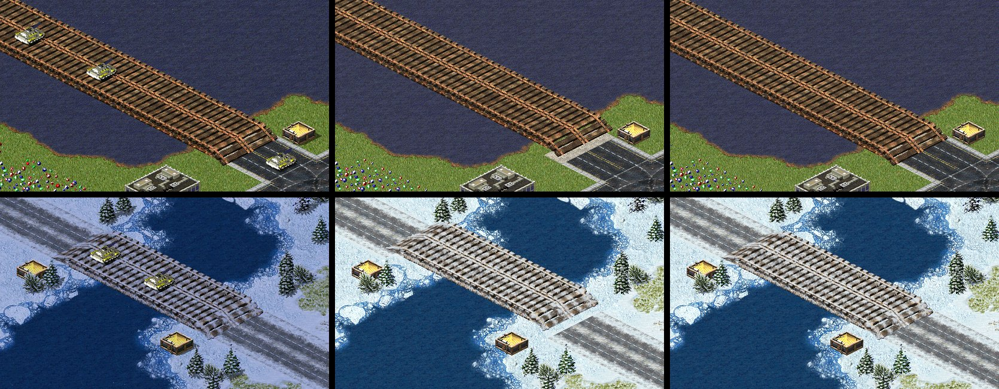

# Is low-bridge art drawn one row too high?

Issue #67. Follows [ra2-bridge-deck-width.md](ra2-bridge-deck-width.md) and [ra2-file-formats.md](ra2-file-formats.md).

## Answer

**Yes. The real game draws low-bridge overlays exactly 15 px lower than we do.** Our placement copies CNCMaps, and CNCMaps' anchor for ordinary overlays is 15 px (one height level, half a cell) too high. The tanks are right, so the fix is in the art: move the art down 15 px and leave the tanks where they are.

*Left: YR in-game capture. Middle: our placement today. Right: our placement with low-bridge overlays moved down 15 px. Top row: Oceansid, east end of the bridge at (117..133, 75..77). Bottom row: 2_arctic_circle, bridge at (147..155, 40..42). The game's Rhinos sit on their cells: (125,76) and (121,76) on the deck, (135,76) on the road. In the middle panel the ramp stops a row short of the road and leaves bare pavement. In the right panel it meets the road, as in the game.*

## Measurement

The captures were matched to our 1:1 composite (terrain chunks plus `placeObjects` output, painted in `z` order; no Pixi) by normalised cross-correlation of greyscale patches. "Offset" means game pixel minus our pixel.

| Map (theater, cell level) | Terrain, trees, buildings | Low bridge as we place it | Low bridge moved down 15 px |
|---|---|---|---|
| Oceansid (URBAN, z=2) | (49, 65): tower, office, lighthouse, shoreline all agree | (49, **80**): middle span, west ramp, east ramp | (49, 65); correlation at the ramps rises 0.73 to 0.99 (west) and 0.59 to 0.98 (east) |
| 2_arctic_circle (SNOW, z=1) | (−275, −54): trees, road, shore all agree | (−275, **−39**) | (−275, −54) |

So everything else we draw (tiles, trees, buildings) lines up with the game. Low bridges alone come out 15 px high, the same in both theaters, at both cell levels, and for both span pieces (`LOBRDG01–04`) and ramps (`LOBRDG19`, `LOBRDG21`).

The Rhinos confirm the tank side. Each Rhino the game drew sits within about 5 px of where our grid puts its cell's centre: (125,76) at (849,565) predicted against (848,560) seen, and (135,76) at (1149,715) against (1148,710). Tanks on a low bridge stay at ground level in both. Only the art is off.

## Cause: gamemd's overlay offset table

`CellClass::DrawOverlay` (gamemd `0x47F6A0`, YRpp `CellClass.h` `DrawOverlay`) adds the result of `0x480110` to the cell's screen position (call at `0x47F6D6`). Disassembled from the install's `gamemd.exe` with Capstone:

- **`0x5FDCC0`, per-type offset.** It returns `(0, 0)`. Y becomes **−12** if the type is `Tiberium`, `Wall` or `Crate`, or if its `ArrayIndex` is 126. It goes 1 lower again for `Land=Railroad`, and again for index 126. The fields are identified from `OverlayTypeClass` INI loading at `0x5FE7A4–0x5FE828`, which writes `Land` to +0x298, `Wall` to +0x2A8, `Tiberium` to +0x2A9 and `Crate` to +0x2AA.
- **`0x480110`, cell part.** If bit `0x80` of the cell's `Flags` (+0x140) is set (the high-bridge deck bit; `DrawOverlay` adds 4 levels for it at `0x47F6F8–0x47F708`), Y gets **−16**, and **−15 more** for `OverlayData` 9..17. Otherwise, if the overlay index is 239 (`RUBBLE_OVERLAY`), Y gets −15. Then X gets +30, and Y gets `+15 − 15·Level` plus a global at `0x886FA4`.

Low bridges (`LOBRDG*`, `LOBRDB*`, `LOBRDGE*`, `LOBRDGB*`) are `Land=Road` with none of those flags, so they take the plain path: Y offset 0. Walls and ore take −12, and high bridges −16 (frames 0–8) or −31 (frames 9–17).

CNCMaps matched the special cases against the game but left the plain case behind:

| Class | gamemd Y offset | CNCMaps Y offset (canvas centred on tile top + (30, ·)) | gamemd + 15 |
|---|---|---|---|
| Ore/gems | −12 | +3 (`ObjectCollection.cs` 203–210) | +3 ✓ |
| Walls | −12 | +3 (`Drawable.cs` 138–144) | +3 ✓ |
| High bridge, frames 0–8 | −16 | −1 (`DrawProperties.cs` 69–75) | −1 ✓ |
| High bridge, frames 9–17 | −31 | −16 (same) | −16 ✓ |
| **Everything else, low bridges included** | **0** | **0** (`ObjectCollection.cs` 146–148, no override) | **+15 ✗** |

Three CNCMaps offsets that were tuned against the game all sit at gamemd + 15. The plain case would need +15 too, and the captures measure exactly +15 for it. CNCMaps' comment at `ShpRenderer.cs` 119–120 already names `0x480110` ("an overlay is drawn from its cell's level alone") but uses the function only for ramp lift, not for this table.

No INI key moves the art. `rulesmd [LOBRDG01]` is `Image, Name, Land=Road, RadarColor, NoUseTileLandType, RadarInvisible`, and `artmd [LOBRDG01]` is `Theater=yes; DemandLoad=true`. The vanilla `OverlayTypeClass` INI reader (`0x5FE7A4–0x5FE9DE`) reads no offset key. The only overlay key Phobos adds is `ZAdjust`, which is depth only (`Ext/OverlayType/Hooks.cpp`, hook at `0x47F71D`).

### Corroboration: OpenRA (Tiberian Sun)

OpenRA's TS mod imports low-bridge overlays as one actor per 1×3 (or 3×1) footprint (`ImportTiberianSunMapCommand.cs` 79–107 and 131ff; `ImportGen2MapCommand.cs` 465–482). It draws frame 1 (`Start: 1`) centred on the footprint centre, which is the middle cell's centre, with `Offset: 0, 0, 1` (`mods/ts/sequences/bridges.yaml` 1–6). 1×1 buildings take `Offset: 0, -12, 12` (`mods/ts/sequences/civilian.yaml` 6), half a TS tile up, which is CNCMaps' top-corner anchor. So OpenRA also puts low bridges half a cell below the building/overlay anchor. At RA2's 30 px tile height that is 15 px. [TS] OpenRA's RA2 mod (`OpenRA/ra2`) has no low-bridge actors to compare against.

## The art itself

Every low-bridge SHP checked is a 180×120 canvas (`lobrdg01–04, 19, 21` in `.urb` and `.sno`). Only frame 1 holds pixels: 115–119 × 59–73 at (30, 19) or (30, 30). `LOBRDG04` also has frame 3. The map stores 0/1/2 across the bridge's three rows, so only the middle row draws. That frame spans all three rows, as [ra2-bridge-deck-width.md](ra2-bridge-deck-width.md) found for high bridges. Placed our way, frame 1's 117×70 box is centred 21 px above the middle cell's centre. After the +15 shift it is 6 px above, consistent with a deck at ground level and railings and edges in the box.

## Our code

`src/battlefield/objects.ts`:

- line 123: low bridges fall through to the generic branch, `place(type, cx, cy, frame, 'iso', 30, 0, depth, 'overlay')`, which uses CNCMaps' `(30, 0)`.
- lines 103–104: `y = (cx + cy − z0)·15 − originY + dy − ⌊shp.cy/2⌋ + h.y`, the tile top plus `dy` with the canvas centred. No per-type adjustment exists apart from ore and walls (+3) and high bridges (−1/−16) at lines 118–122.
- `src/battlefield/grid.ts` 56: `isLowBridge = /^LOBRD/i`, which covers `LOBRDG*`, `LOBRDGE*`, `LOBRDGB*` and `LOBRDB*`. Low-bridge cells keep their own level (no deck).

On the gamemd + 15 scale, the right generic `dy` is **15**. Following the same table, other generic overlays have the same 15 px error: rocks (`SROCK*`, `TROCK*`, `LUNRK*`), crates and drums (`CRAT0*`, `DRUM0*`, `PALET0*`), `FENCE01–22`, `RAILBRDG1/2`, `BARB`, `WOOD`. A few types differ. `TRACKS*`/`TRACKTUNNEL*` (`Land=Railroad`) should get +14. `RUBBLE_OVERLAY` (index 239) stays at 0. `CRATE`/`WCRATE` (`Crate=yes`) should get +3, like walls. [Inf] This follows from the disassembly. Only low bridges were captured in-game.

## Caveats

- **Modified engine.** The test client injects Ares, Phobos and the CnCNet spawner, as in the earlier tests. None of the Phobos hooks inside `DrawOverlay` (`0x47F71D` ZAdjust, `0x47F87D`, `0x47F974` walls, `0x47FA1F` veins palette) changes the location. The offset table above was read from the unpatched `gamemd.exe`. [Inf]
- **Only low bridges were captured.** The +15 for other generic overlays, and the +14, 0 and +3 exceptions, are inferred from the table and not seen in-game.
- **The two lie together.** On every cell, "one level lower" and "half a cell lower" are the same 15 px, so for drawing it doesn't matter which one the game means.
- **ModEnc** returned HTTP 403 to this session and wasn't consulted. Nothing above relies on it.

## Test

Scratch scripts, not committed. They reuse `run()`, `team_type()` and `waypoint_letters()` from `tools/corner-cut-test/corner_cut_test.py`. Each one writes the map's own text (Oceansid: `oceansid.map` extracted from `Oceansid.mmx`; 2_arctic_circle: the loose map) with `[Digest]` removed. It adds waypoints, a reveal and camera-jump trigger, and one-Rhino reinforcement teams (action 80, `<Player @ A>`, script `3,<own waypoint>`) on chosen cells. It then launches through Syringe and records the desktop for 35 s. Frame 25 of each recording was matched to our composite as described above. Run twice on 2026-10-31 on the owner's install, Oceansid then 2_arctic_circle. Everything the script touched in the install was restored afterwards.

## Sources

- In-game captures above (YR via `gamemd-spawn.exe` + Syringe, 1920×1080 windowed).
- `gamemd.exe` from the install, disassembled with Capstone: `0x47F6A0` (`CellClass::DrawOverlay`), `0x480110`, `0x5FDCC0`, `0x5FE7A4–0x5FE9DE` (`OverlayTypeClass` INI reading).
- YRpp @ f14642c: `CellClass.h` (`DrawOverlay` 0x47F6A0, `Level`, `OverlayData`, `Flags` layout), `OverlayTypeClass.h` (field order), `GeneralDefinitions.h` (`LandType`, `CellFlags`).
- Phobos @ 5f90b96: `src/Ext/OverlayType/Hooks.cpp`, `src/Ext/Tiberium/Hooks.cpp`, `src/Misc/Hooks.VeinholeMonster.cpp`.
- CNCMaps (zzattack/ccmaps-net) @ 56712d7: `CNCMaps.Engine/Game/ObjectCollection.cs` 146–148, 203–217; `Game/DrawProperties.cs` 69–75; `Drawables/Drawable.cs` 138–144; `Rendering/ShpRenderer.cs` 115–120; `Game/SpecialOverlays.cs` 56–58.
- OpenRA @ 9636b63: `OpenRA.Mods.Cnc/UtilityCommands/ImportTiberianSunMapCommand.cs` 79–107, 131ff; `ImportGen2MapCommand.cs` 465–482; `mods/ts/sequences/bridges.yaml` 1–6; `mods/ts/sequences/civilian.yaml` 6; `mods/ts/rules/bridges.yaml` (`LOBRDG_A/B` footprints).
- Install: `rulesmd.ini`/`artmd.ini` `[LOBRDG*]`, `[OverlayTypes]`; SHP headers of `lobrdg01–04, 19, 21` (`.urb`, `.sno`); `Oceansid.mmx`, `Maps/Yuri's Revenge/2_arctic_circle.map`.
- Our code: `src/battlefield/objects.ts` 103–104, 118–123; `src/battlefield/grid.ts` 56.

## Triage verdict

**A CNCMaps bug we copied.** Confidence for low bridges is **high**: two in-game captures in two theaters measure exactly +15 px, terrain, trees and buildings line up with the game in both, and gamemd's offset table explains the number. Fix the art, not the tanks: generic-overlay `dy` becomes 15 in `placeObjects`. Bump `IMPORT_VERSION` with the fix, or the browser keeps serving the old render. Confidence that other generic overlays (rocks, crates, fences, rail bridges) share the error, and in the +14, 0 and +3 exceptions, is **medium**: it comes from the disassembly only. One capture of a map with `SROCK*`/`TROCK*` or `CRAT0*` overlays, and one with `TRACKS*`, matched the same way, would settle it.
